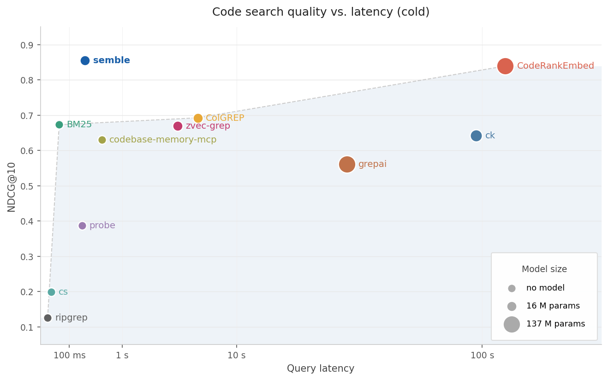
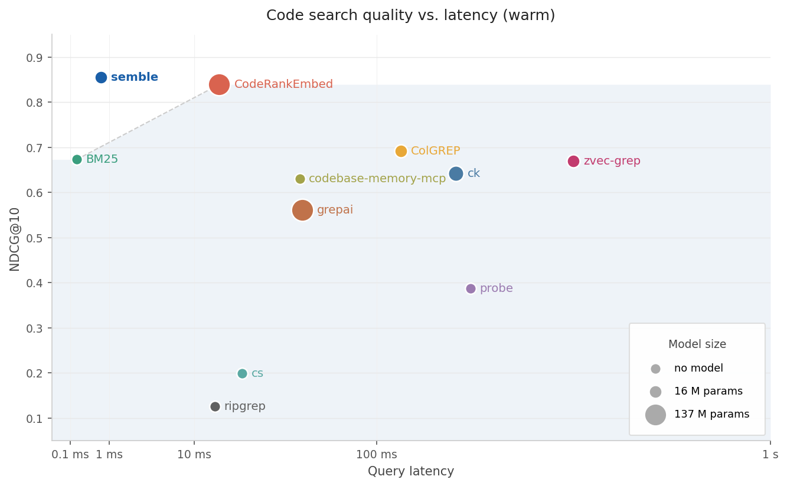
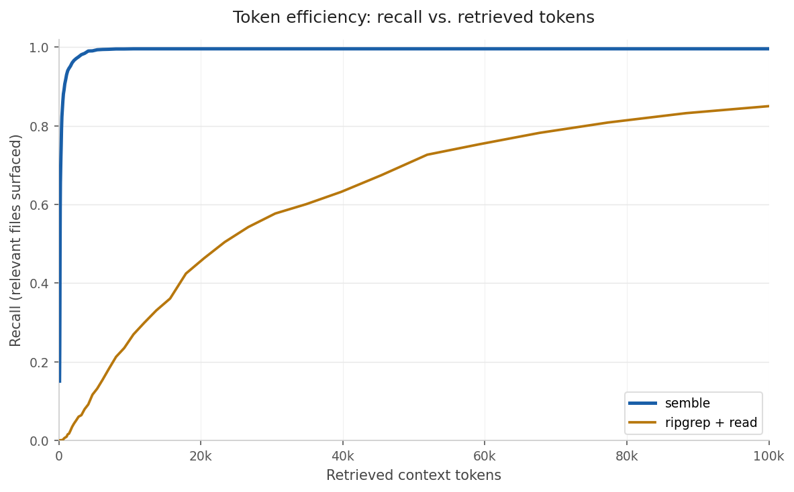

# Benchmarks

These quality and speed measurements were imported from upstream Semble. They describe the saved upstream runs, not this offline distribution. [Running the benchmarks](#running-the-benchmarks) uses a connected environment: runners can clone repositories and download baseline models or tools.

## Main results

| Method               |   NDCG@10 |      Index |   Query p50 |
| -------------------- | --------: | ---------: | ----------: |
| **semble**           | **0.855** | **240 ms** | **0.69 ms** |
| CodeRankEmbed        |     0.839 |      116 s |       16 ms |
| ColGREP              |     0.693 |      5.4 s |      122 ms |
| BM25                 |     0.673 |      47 ms |     0.17 ms |
| zvec-grep            |     0.670 |      3.4 s |      391 ms |
| ck                   |     0.642 |       96 s |      187 ms |
| codebase-memory-mcp  |     0.630 |     454 ms |       46 ms |
| grepai               |     0.561 |       35 s |       48 ms |
| probe                |     0.387 |          - |      207 ms |
| cs                   |     0.200 |          - |       22 ms |
| ripgrep              |     0.126 |          - |       14 ms |

|  |  |
| --- | --- |
| Index + query time vs NDCG@10 | Warm query latency vs NDCG@10 |

Saved quality scores average per-repository NDCG@10 scores, with each query scored against its annotated targets. The console summary averages languages instead, so its overall value can differ. The Semble quality result is from [5fbcd035d594](results/semble-hybrid-5fbcd035d594.json); the displayed chart inputs are recorded in [plot.py](plot.py).

The speed runner uses one repository per language on CPU, excluding model loading from Semble and CodeRankEmbed index time. It pools five query runs for Semble, BM25, CodeRankEmbed, and zvec-grep, three for ripgrep, and one for ColGREP. [speed-5fbcd035d594.json](results/speed-5fbcd035d594.json) supplies Semble's timing; [speed-5fcc8a0a7b89.json](results/speed-5fcc8a0a7b89.json) supplies CodeRankEmbed, BM25, ColGREP, zvec-grep, and ripgrep timings. Other methods use timings from their separate quality-baseline runs, with different repository scopes and repetition counts.

## Token efficiency

This compares Semble's top-50 chunks with a keyword-search-and-read workflow over 1,251 queries, using the [5fbcd035d594 snapshot](results/token-efficiency-5fbcd035d594.json).



For each query, the keyword baseline drops stopwords and short words, runs `rg --fixed-strings --ignore-case` for each keyword, ranks files by the number of distinct matching keywords, and reads those files in full. Both methods use the same file types and ignored directories. Tokens are counted with `cl100k_base` through `tiktoken`.

### Expected tokens per query

Average cumulative tokens at the first relevant hit, assigning 32,000 tokens when no hit is found. Successful hits are not capped, so the average can exceed 32,000.

| Method | Expected tokens | Savings |
| --- | ---: | ---: |
| Keyword ripgrep + read file | 47,199 | baseline |
| Semble | 353 | 99% fewer |

### Recall at fixed token budgets

A target is covered when a retrieved unit overlaps its annotated line span, or matches its file when no span is annotated. Recall is the fraction of covered targets within the token budget, averaged across queries.

| Method | 500 | 1k | 2k | 4k | 8k | 16k | 32k |
| --- | ---: | ---: | ---: | ---: | ---: | ---: | ---: |
| Semble | 0.843 | 0.921 | 0.963 | 0.989 | 0.995 | 0.996 | 0.996 |
| Keyword ripgrep + read file | 0.001 | 0.008 | 0.037 | 0.087 | 0.211 | 0.372 | 0.584 |

## By language

NDCG@10 per language, sorted by Semble. CRE = CodeRankEmbed; cbm = codebase-memory-mcp. Best score per row is bolded.

| Language    |    semble |       CRE |   ColGREP |  zvec-grep |        ck |       cbm |    grepai |     probe |        cs |   ripgrep |
| ----------- | --------: | --------: | --------: | ---------: | --------: | --------: | --------: | --------: | --------: | --------: |
| scala       |     0.921 | **0.925** |     0.765 |      0.799 |     0.717 |     0.704 |     0.330 |     0.392 |     0.111 |     0.180 |
| javascript  |     0.911 | **0.925** |     0.823 |      0.760 |     0.772 |     0.770 |     0.675 |     0.588 |     0.171 |     0.176 |
| go          | **0.910** |     0.713 |     0.785 |      0.512 |     0.458 |     0.506 |     0.722 |     0.410 |     0.183 |     0.133 |
| ruby        | **0.909** |     0.905 |     0.708 |      0.758 |     0.738 |     0.689 |     0.643 |     0.382 |     0.255 |     0.230 |
| elixir      | **0.905** |     0.893 |     0.808 |      0.811 |     0.786 |     0.506 |     0.669 |     0.412 |     0.397 |     0.134 |
| zig         |     0.899 | **0.911** |     0.474 |      0.664 |     0.511 |     0.766 |     0.755 |     0.369 |     0.121 |     0.000 |
| cpp         |     0.881 | **0.897** |     0.626 |      0.677 |     0.687 |     0.630 |     0.731 |     0.375 |     0.262 |     0.126 |
| python      |     0.876 | **0.878** |     0.777 |      0.704 |     0.721 |     0.643 |     0.634 |     0.488 |     0.305 |     0.202 |
| csharp      | **0.872** |     0.848 |     0.614 |      0.609 |     0.548 |     0.775 |     0.277 |     0.392 |     0.248 |     0.117 |
| php         | **0.864** |     0.847 |     0.663 |      0.583 |     0.615 |     0.608 |     0.402 |     0.340 |     0.180 |     0.123 |
| swift       | **0.848** |     0.845 |     0.710 |      0.709 |     0.672 |     0.630 |     0.429 |     0.280 |     0.151 |     0.160 |
| bash        | **0.840** |     0.834 |     0.706 |      0.725 |     0.677 |     0.768 |     0.723 |     0.226 |     0.170 |     0.000 |
| lua         | **0.835** |     0.829 |     0.798 |      0.736 |     0.738 |     0.591 |     0.699 |     0.336 |     0.050 |     0.000 |
| java        | **0.828** |     0.790 |     0.641 |      0.685 |     0.606 |     0.554 |     0.386 |     0.536 |     0.136 |     0.198 |
| rust        | **0.826** |     0.754 |     0.662 |      0.541 |     0.419 |     0.454 |     0.519 |     0.242 |     0.193 |     0.162 |
| kotlin      |     0.803 | **0.823** |     0.637 |      0.628 |     0.587 |     0.611 |     0.478 |     0.335 |     0.170 |     0.166 |
| haskell     |     0.775 | **0.811** |     0.683 |      0.689 |     0.733 |     0.624 |     0.483 |     0.313 |     0.160 |     0.000 |
| c           |     0.750 | **0.771** |     0.676 |      0.598 |     0.606 |     0.655 |     0.555 |     0.384 |     0.175 |     0.000 |
| typescript  | **0.742** |     0.671 |     0.430 |      0.476 |     0.456 |     0.455 |     0.394 |     0.354 |     0.145 |     0.128 |
| **overall** | **0.855** |     0.839 |     0.693 |      0.670 |     0.642 |     0.630 |     0.561 |     0.387 |     0.200 |     0.126 |

## Ablations

`raw` returns retrieval scores directly; `+ ranking` applies Semble's hybrid ranker. These values come from [semble-ablations-5fbcd035d594.json](results/semble-ablations-5fbcd035d594.json).

| Retrieval              |   Raw | + ranking |
| ---------------------- | ----: | --------: |
| BM25                      | 0.686 |     0.838 |
| potion-code-16M-v2        | 0.652 |     0.824 |
| BM25 + potion-code-16M-v2 |     - | **0.855** |

### By query category

| Mode                               | Architecture |  Semantic |    Symbol |
| ---------------------------------- | -----------: | --------: | --------: |
| BM25 raw                           |        0.642 |     0.680 |     0.748 |
| potion-code-16M-v2 raw             |        0.636 |     0.671 |     0.620 |
| semble BM25 (+ ranking)            |        0.794 |     0.817 |     0.962 |
| semble potion-code-16M-v2 (+ ranking) |      0.768 |     0.819 |     0.917 |
| **semble hybrid**                  |    **0.808** | **0.847** | **0.954** |


## Dataset

[repos.json](repos.json) pins 63 repositories across 19 languages. The [annotations](annotations/) contain 1,251 queries:

| Category | Queries | What it tests |
| --- | ---: | --- |
| semantic | 703 | Code implementing a behavior or concept |
| architecture | 344 | Design decisions, module boundaries, structural patterns |
| symbol | 204 | Named function, class, type, or variable lookup |

There are three repositories per language, except Python with nine: Bash, C, C++, C#, Elixir, Go, Haskell, Java, JavaScript, Kotlin, Lua, PHP, Python, Ruby, Rust, Scala, Swift, TypeScript, and Zig. Upstream generated queries and relevance labels with Claude Sonnet 4.6 and used the same model to judge label quality.

## Methods and prerequisites

The command suffixes below are modules under `benchmarks.baselines`.

| Method | Retrieval configuration | Prerequisite |
| --- | --- | --- |
| [ripgrep](https://github.com/BurntSushi/ripgrep) (`ripgrep`) | Raw keyword matches | `rg` on PATH; `brew install ripgrep` or `apt install ripgrep` |
| [probe](https://github.com/buger/probe) (`probe`) | BM25 with tree-sitter; free search mode | `npm install -g @buger/probe`; paid agent mode is not measured |
| [Code Spelunker](https://github.com/boyter/cs) (`cs`) | Structural BM25 over code, comments, and strings | `go install github.com/boyter/cs/v3@latest` |
| [ColGREP](https://github.com/lightonai/next-plaid/tree/main/colgrep) (`colgrep`) | Late interaction with [LateOn-Code-edge](https://huggingface.co/lightonai/LateOn-Code-edge) | `colgrep` on PATH |
| [grepai](https://github.com/nicholasgasior/grepai) (`grepai`) | [nomic-embed-text](https://huggingface.co/nomic-ai/nomic-embed-text-v1), 137M parameters | `grepai` on PATH and Ollama running; `ollama pull nomic-embed-text` |
| [codebase-memory-mcp](https://github.com/DeusData/codebase-memory-mcp) (`codebase_memory`) | `search_graph` in fast mode, using structural BM25 | `python -m pip install codebase-memory-mcp`; first run downloads a platform binary |
| [ck](https://github.com/BeaconBay/ck) (`ck`) | Regex and semantic search with [bge-small-en-v1.5](https://huggingface.co/BAAI/bge-small-en-v1.5) | `cargo install ck-search` or `npm install -g @beaconbay/ck-search`; model downloads on first use |
| [zvec-grep](https://github.com/zvec-ai/zvec-grep) (`zvecgrep`) | potion-code-16M-v2 + BM25 in direct mode | Node.js 22+; `npm install -g @zvec/zvec-grep@0.2.1`; model downloads on first index |
| [CodeRankEmbed](https://huggingface.co/nomic-ai/CodeRankEmbed) (`coderankembed`) | Semantic search with a 137M-parameter transformer | Benchmark extra in the upstream environment below |
| [Semble](../README.md) | potion-code-16M-v2 + BM25 + reranking | Upstream installation below |

The zvec-grep measurements use 0.2.1; the runner records its installed version and parses its human-readable output. ColGREP runs with `--code-only` except for Bash repositories (bash-it, bats-core, nvm), where its code filter excludes `.sh` and `.bash`. codebase-memory-mcp creates `semble-bench-<repo>` projects and deletes them after evaluation.

## Running the benchmarks

Use a separate connected Python environment with upstream Semble 0.7.3 installed, and run these commands from this checkout:

```bash
python -m pip install "semble[benchmark]==0.7.3"
python -m benchmarks.sync_repos
python -m benchmarks.sync_repos --check
python -m benchmarks.run_benchmark
```

The runners import upstream's `semble.utils.DEFAULT_MODEL_NAME`, which the offline distribution does not expose. An editable install of this checkout cannot run those imports. Repository checkouts are stored in `~/.cache/semble-bench`.

Most quality runners accept repeatable `--repo` and `--language` filters:

```bash
python -m benchmarks.run_benchmark --repo fastapi --repo axios
python -m benchmarks.run_benchmark --language python
python -m benchmarks.baselines.probe --repo fastapi --repo axios
```

Run another baseline by substituting its module suffix from the methods table, for example `python -m benchmarks.baselines.ck`. Ripgrep accepts `--no-fixed-strings` to use regex matching.

### Speed and ablations

```bash
python -m benchmarks.speed_benchmark
python -m benchmarks.speed_benchmark --tools semble zvec-grep
python -m benchmarks.speed_benchmark --repo flask --repo axios
python -m benchmarks.baselines.ablations
```

Speed defaults to one representative repository per language. Ablations run all configured retrieval/ranking modes; the runner has no `--mode` option.

Historical CodeRankEmbed quality results are in [coderankembed-812d8e74b9d0.json](results/coderankembed-812d8e74b9d0.json).

For large grepai repositories, increase its embedding timeout. An explicit output file enables resuming completed repositories:

```bash
python -m benchmarks.baselines.grepai --timeout 1800 --output /tmp/grepai-results.json
```

### Token efficiency and plots

```bash
python -m benchmarks.token_efficiency recall
python -m benchmarks.token_efficiency recall --repo fastapi
python -m benchmarks.token_efficiency plot --input benchmarks/results/token-efficiency-5fbcd035d594.json
python -m benchmarks.plot
```

Default result files use `benchmarks/results/<method>-<sha12>.json`. Token-efficiency recall also writes `assets/images/token_efficiency.png` unless `--no-plot` is set; its `plot` command accepts an explicit saved payload. The separate `benchmarks.plot` module uses its embedded `_METHODS` values to write `speed_vs_ndcg_cold.png` and `speed_vs_ndcg_warm.png`; update those values when plotting a different measurement set. Keep generated outputs untracked.

## Excluded methods

Upstream excluded these configurations from the comparison:

- [codanna](https://codanna.io): missing Haskell, Bash, Zig, Scala, Elixir, and Ruby support at the time of comparison.
- [claude-context](https://github.com/zilliztech/claude-context): required a paid OpenAI API key and a running vector database.
- [GitNexus](https://github.com/abhigyanpatwari/GitNexus): missing Bash, Elixir, Haskell, Lua, Scala, and Zig support at the time of comparison.
- [codegraph](https://github.com/colbymchenry/codegraph): missing Haskell, Bash, Elixir, and Zig support at the time of comparison.
- [tgrep](https://github.com/microsoft/tgrep): measured 0.1255 NDCG@10, close to ripgrep's 0.1259, without a useful speed advantage in these runs.
